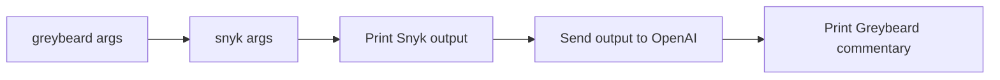

# snyk-cli-greybeard

A wrapper around the [Snyk CLI](https://docs.snyk.io/snyk-cli) that adds commentary from a grumpy old security expert.

You run `greybeard` instead of `snyk`. It runs Snyk with your arguments, prints the normal Snyk output, and then prints a sarcastic summary of the important findings. The summary comes from OpenAI.

## Before you start

You need two things:

- The [Snyk CLI](https://docs.snyk.io/snyk-cli/install-the-snyk-cli), installed and signed in (`snyk auth`).
- An [OpenAI API key](https://platform.openai.com/api-keys). Greybeard does not work without it. Each run makes one API call, and OpenAI can charge you for it.

**Privacy note:** Greybeard sends the full Snyk output to the OpenAI API (model `gpt-4o`). That output can include package names, file paths, and vulnerability details. Do not use Greybeard if you cannot share this data with OpenAI.

## Install

### Installer script (Linux, macOS, Windows)

```bash
/bin/bash -c "$(curl -fsSL https://raw.githubusercontent.com/snyk-labs/snyk-cli-greybeard/refs/heads/main/install.sh)"
```

The script downloads the latest release for your system. On Windows, run it in Git Bash or WSL.

On Linux and macOS, it installs `greybeard` in the first of these folders that exists and that you can write to: `/usr/local/bin`, `~/.local/bin`, `~/bin`. If none qualifies, it creates `~/.local/bin`. On Windows, it installs to `%APPDATA%\snyk-cli-greybeard`. If the folder is not in your `PATH`, the script tells you how to add it.

### Download a binary

Download the file for your system from the [Releases](https://github.com/snyk-labs/snyk-cli-greybeard/releases) page. Rename it to `greybeard` and put it in a folder in your `PATH`. On Linux and macOS, run `chmod +x greybeard` first.

### Build from source

You need [Go](https://go.dev/doc/install) 1.22.5 or later.

```bash
git clone https://github.com/snyk-labs/snyk-cli-greybeard.git
cd snyk-cli-greybeard
go build -o greybeard
```

To build and copy the binary to `/usr/local/bin` (Linux and macOS), run `make install`. Use `sudo make install` if you cannot write to that folder.

Other `make` targets:

- `make compile` builds binaries for all supported systems into `dist/`.
- `make clean` removes build output.
- `make help` lists the targets.

## Set your OpenAI API key

Greybeard reads the key from the `OPENAI_API_KEY` environment variable. This is the only setting.

Linux and macOS:

```bash
export OPENAI_API_KEY="your-api-key"
```

Windows PowerShell:

```powershell
$env:OPENAI_API_KEY = "your-api-key"
```

These commands last for the current terminal session only. To keep the key, add the `export` line to your shell profile (for example `~/.bashrc` or `~/.zshrc`). On Windows, use `setx OPENAI_API_KEY "your-api-key"` and open a new terminal.

## Use it

Use `greybeard` in place of `snyk`. It passes all arguments to Snyk.

```bash
greybeard test
greybeard test --json
greybeard container test alpine:latest
```

To show the Greybeard version, run `greybeard --version`.

Greybeard works like this:



Things to know:

- Greybeard waits for Snyk to finish before it prints anything.
- Greybeard does not pass your keyboard input to Snyk. Run commands that ask questions, such as `snyk auth`, with `snyk` directly.
- The exit code is the exit code of Snyk, even when the OpenAI call fails.
- If the OpenAI call fails or takes more than 30 seconds, you see an error message after the Snyk output.
- The commentary is not always the same. The model is told to focus on real security findings and to skip minor warnings. It can still get things wrong, so check the raw Snyk output.

## Example

The commentary below is an example. Your output will be different.

```text
Raw Snyk CLI Output:
[The original Snyk CLI output appears here]

-----------------------------------------------------------

🧔‍♂️ Security Greybeard says:

Listen up, youngster! I see you've got a critical RCE vulnerability in that package.
Back in my day, we'd have been fired for leaving something this obvious in production.
You better fix this ASAP unless you want your servers to become someone else's bitcoin miner...
```

## License

MIT
